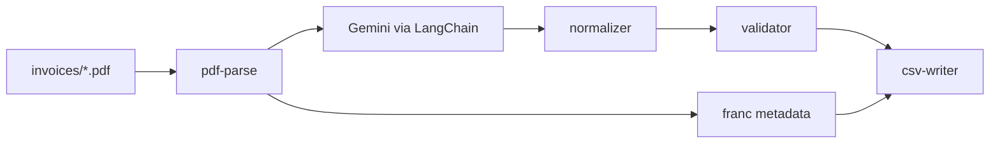

# LLM Utility Invoice Extraction

Extract structured data from multilingual utility invoices (electricity, gas, water) using **Gemini 3.1 Flash-Lite Preview**, **LangChain**, and **Zod**, and output results as CSV.

## Quickstart

```bash
npm install
cp .env.example .env   # add GOOGLE_API_KEY
npm run extract -- --input invoices --output output/extracted_invoices.csv
npm test
```

### Environment variables

| Variable         | Required | Default                         |
| ---------------- | -------- | ------------------------------- |
| `GOOGLE_API_KEY` | Yes      | —                               |
| `GEMINI_MODEL`   | No       | `gemini-3.1-flash-lite-preview` |

## Architecture



**Pipeline order:** `text → language detect → LLM extract → normalize → validate → CSV`

## Assumptions

| Assumption                                | Rationale                                |
| ----------------------------------------- | ---------------------------------------- |
| Text extracted via `pdf-parse` (no OCR)   | Fixtures are text-based PDFs             |
| Missing or ambiguous fields → empty cells | Nullable Zod fields                      |
| Dates normalized to ISO 8601              | Consistent downstream use                |
| No translation layer                      | Gemini reads multilingual text natively  |
| franc is metadata-only                    | Debugging enrichment, not transformation |

## Multilingual handling

- **Extraction:** Gemini parses English, Spanish, French, and UK English layouts without translating the document.
- **Detection:** `franc` adds `detected_language` and `language_confidence` to CSV for debugging.
- **Normalization:** `normalizer.ts` maps dates, units, and utility-type synonyms post-LLM (for example, `agua` → `water`).

## Features

### Language detection and normalization

- franc → ISO 639-1 in `language-detector.ts`
- Structural normalization in `normalizer.ts` (dates, units, utility types)
- Vendor and address preserved as printed

### Confidence metadata

- `extraction_confidence` — LLM self-score for the whole record
- `field_confidence` — per-field JSON scores from the LLM
- `language_confidence` — franc top-2 score heuristic
- `low_extraction_confidence` warning when the score is below `0.5`

### Validation checks

Cross-field rules in `invoice.validator.ts`:

| Code                     | Rule                             |
| ------------------------ | -------------------------------- |
| `invalid_billing_period` | start > end                      |
| `negative_usage`         | usage < 0                        |
| `future_invoice_date`    | date > tomorrow                  |
| `missing_required_field` | null usage, unit, or address     |
| `unit_type_mismatch`     | for example, gas paired with kWh |

Warnings appear in `validation_warnings` (semicolon-separated). Rows are never dropped.

### Modular design

Port interfaces in `src/ports/`:

- `TextExtractorPort` — swap in an OCR adapter
- `LanguageDetectorPort` — swap the detection library
- `InvoiceExtractorPort` — swap the LLM provider
- `OutputWriterPort` — add JSON or another output format

The pipeline accepts injected dependencies through `resolvePipelineDeps()`; see `tests/services/pipeline.test.ts`.

## Project structure

```text
src/
  ports/          # interfaces
  domain/         # schema, normalizer, validator
  services/       # adapters and pipeline
  cli/extract.ts  # CLI entry point
invoices/         # sample PDFs
output/           # generated CSV
tests/            # Vitest suite
docs/             # project invariants
```

## Scripts

| Command             | Description                               |
| ------------------- | ----------------------------------------- |
| `npm run extract`   | Run extraction pipeline                   |
| `npm test`          | Unit and integration tests (mocked LLM)   |
| `npm run test:live` | Live Gemini smoke test (requires API key) |
| `npm run build`     | Compile TypeScript to `dist/`             |

## Testing approach

Full write-up: [TESTING.md](TESTING.md). Summary:

1. **Accuracy validation** — Manual spot-checks of the sample PDFs against `output/extracted_invoices.csv`, plus Zod parsing and cross-field validation rules.
2. **Edge cases** — Missing dates and fields, English/Spanish/French invoices, US/EU dates, unit variants (kWh, therms, m³, CCF), and ambiguous usage.
3. **Automated tests** — 45 Vitest tests covering schemas, normalization, validation, PDF extraction, language detection, and the mocked pipeline. Optional live Gemini test: `npm run test:live`.
4. **Roadmap** — Golden-file CSV regression, labeled ground truth, field-level metrics, calibrated confidence, and retry policies.

```bash
npm test
```

## Current limitations

- Confidence scores are LLM self-assessments rather than calibrated metrics.
- Strict parsing falls back to lenient normalization when needed.
- PDF extraction currently requires text-based PDFs; OCR is not included.
- CI uses a mocked LLM; live API testing is optional.

## See also

- [TESTING.md](TESTING.md) — validation approach
- [docs/INVARIANTS.md](docs/INVARIANTS.md) — project rules
