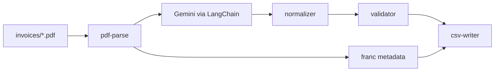

# LLM Utility Invoice Extraction

Extract structured data from multilingual utility invoices (electricity, gas, water) using **Gemini 3.1 Flash-Lite Preview**, **LangChain**, and **Zod**, and output results as CSV.

## Quickstart

```bash
npm install
cp .env.example .env   # add GOOGLE_API_KEY
npm run extract -- --input invoices --output output/extracted_invoices.csv
npm test
```

### Environment variables

| Variable         | Required | Default                         |
| ---------------- | -------- | ------------------------------- |
| `GOOGLE_API_KEY` | Yes      | �                               |
| `GEMINI_MODEL`   | No       | `gemini-3.1-flash-lite-preview` |

## Architecture



**Pipeline order:** `text ? language detect ? LLM extract ? normalize ? validate ? CSV`

## Assumptions

| Assumption                                 | Rationale                                      |
| ------------------------------------------ | ---------------------------------------------- |
| Text extracted via `pdf-parse` (no OCR)    | Fixtures are ReportLab text PDFs               |
| Missing/ambiguous fields ? empty CSV cells | Nullable Zod fields                            |
| Dates normalized to ISO 8601               | Consistent downstream use                      |
| No translation layer                       | Gemini reads multilingual text natively        |
| franc is metadata-only                     | Debugging enrichment, not input transformation |

## Multilingual handling

- **Extraction:** Gemini parses English, Spanish, French, and UK English layouts without translating the document.
- **Detection:** `franc` adds `detected_language` and `language_confidence` to CSV for debugging.
- **Normalization:** `normalizer.ts` maps dates, units, and utility-type synonyms post-LLM (e.g. `agua` ? `water`, `kWh` aliases).

## Bonus coverage

### Language detection / normalization

- franc ? ISO 639-1 in `language-detector.ts`
- Structural normalization in `normalizer.ts` (dates, units, utility types)
- Vendor/address preserved as printed

### Confidence scoring

- `extraction_confidence` � LLM self-score for whole record
- `field_confidence` � per-field JSON scores from LLM
- `language_confidence` � franc top-2 score heuristic
- `low_extraction_confidence` warning when score &lt; 0.5

### Basic validation checks

Cross-field rules in `invoice.validator.ts`:

| Code                     | Rule                         |
| ------------------------ | ---------------------------- |
| `invalid_billing_period` | start &gt; end               |
| `negative_usage`         | usage &lt; 0                 |
| `future_invoice_date`    | date &gt; tomorrow           |
| `missing_required_field` | null usage, unit, or address |
| `unit_type_mismatch`     | e.g. gas + kWh               |

Warnings appear in `validation_warnings` (semicolon-separated). Rows are never dropped.

### Modular / extensible design

Port interfaces in `src/ports/`:

- `TextExtractorPort` � swap OCR adapter later
- `LanguageDetectorPort` � swap detection library
- `InvoiceExtractorPort` � swap LLM provider
- `OutputWriterPort` � add JSON output

Pipeline accepts injected deps via `resolvePipelineDeps()` � see `tests/services/pipeline.test.ts`.

## Project structure

```
src/
  ports/          # interfaces
  domain/         # schema, normalizer, validator
  services/       # adapters + pipeline
  cli/extract.ts  # CLI entry
invoices/         # sample PDFs
output/           # generated CSV
tests/            # vitest suite
docs/             # invariants, commits, phase gates
```

## Scripts

| Command             | Description                               |
| ------------------- | ----------------------------------------- |
| `npm run extract`   | Run extraction pipeline                   |
| `npm test`          | Unit + integration tests (mocked LLM)     |
| `npm run test:live` | Live Gemini smoke test (requires API key) |
| `npm run build`     | Compile TypeScript to `dist/`             |

## Testing approach

Full write-up: **[TESTING.md](TESTING.md)**. Summary:

1. **Accuracy validation** � Manual spot-check of all 5 PDFs against `output/extracted_invoices.csv`, plus Zod parsing and cross-field validation rules.
2. **Edge cases** � Missing dates/fields, English/Spanish/French invoices, US vs EU dates, unit variants (kWh, therms, m�, CCF), ambiguous usage.
3. **Automated tests** � **45** Vitest tests (schema, normalizer, validator, PDF extract, language detect, mocked pipeline). Optional live Gemini test: `npm run test:live`.
4. **Future improvements** � Golden-file CSV regression, labeled ground truth, field-level metrics, calibrated confidence, retry on low confidence.

```bash
npm test
```

## Tradeoffs (4-hour scope)

- LLM self-confidence scores, not calibrated metrics
- Lenient normalization fallback when strict parse fails
- No OCR, queue, or web UI
- Mocked LLM in CI; live API test optional

## See also

- [TESTING.md](TESTING.md) � validation approach
- [docs/INVARIANTS.md](docs/INVARIANTS.md) � project rules
