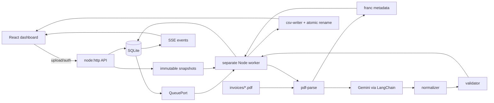

# LLM Utility Invoice Application

Extract structured data from multilingual utility invoices (electricity, gas, water), process batches durably in a local worker, and review/download results from a React dashboard.

## Quickstart

```bash
npm install
cp .env.example .env   # add GOOGLE_API_KEY
npm run server
# another terminal
WORKER_EXTRACTOR=fixture npm run worker
# another terminal
npm run web:dev
npm test
```

Open `http://localhost:5173` for the dashboard. The development worker uses deterministic fixture extraction; set `WORKER_EXTRACTOR=gemini` and configure `GOOGLE_API_KEY` for real extraction.

The original one-shot command remains available:

```bash
npm run extract -- --input invoices --output output/extracted_invoices.csv
```

### Environment variables

| Variable                  | Required                    | Default                         |
| ------------------------- | --------------------------- | ------------------------------- |
| `GOOGLE_API_KEY`          | Gemini worker only          | —                               |
| `GEMINI_MODEL`            | No                          | `gemini-3.1-flash-lite-preview` |
| `DATA_DIR`                | No                          | `./data`                        |
| `API_HOST`                | No                          | `127.0.0.1`                     |
| `API_PORT`                | No                          | `3000`                          |
| `WORKER_EXTRACTOR`        | No                          | `gemini`                        |
| `JOB_LEASE_MS`            | No                          | `30000`                         |
| `WORKER_HEARTBEAT_MS`     | No                          | `5000`                          |
| `WORKER_STALE_MS`         | No                          | `15000`                         |
| `RETRY_BASE_DELAY_MS`     | No                          | `1000`                          |
| `RETRY_MAX_DELAY_MS`      | No                          | `30000`                         |
| `RETRY_MAX_ATTEMPTS`      | No                          | `5`                             |
| `SSE_HEARTBEAT_MS`        | No                          | `15000`                         |
| `MAX_UPLOAD_BYTES`        | No                          | `10485760`                      |
| `OUTBOX_ENCRYPTION_KEY`   | Password reset              | —                               |
| `APP_ENV`                 | No                          | `development`                   |
| `APP_ORIGIN`              | No                          | `http://localhost:3000`         |

`OUTBOX_ENCRYPTION_KEY` must be the base64 encoding of exactly 32 bytes. The included [.env.example](.env.example) provides a development-only value.

## Architecture



**Per-document order:** `text → language detect → LLM extract → normalize → validate → durable record`

## Assumptions

| Assumption                                | Rationale                                |
| ----------------------------------------- | ---------------------------------------- |
| Text extracted via `pdf-parse` (no OCR)   | Fixtures are text-based PDFs             |
| Missing or ambiguous fields → empty cells | Nullable Zod fields                      |
| Dates normalized to ISO 8601              | Consistent downstream use                |
| No translation layer                      | Gemini reads multilingual text natively  |
| franc is metadata-only                    | Debugging enrichment, not transformation |

## Multilingual handling

- **Extraction:** Gemini parses English, Spanish, French, and UK English layouts without translating the document.
- **Detection:** `franc` adds `detected_language` and `language_confidence` to CSV for debugging.
- **Normalization:** `normalizer.ts` maps dates, units, and utility-type synonyms post-LLM (for example, `agua` → `water`).

## Features

### Language detection and normalization

- franc → ISO 639-1 in `language-detector.ts`
- Structural normalization in `normalizer.ts` (dates, units, utility types)
- Vendor and address preserved as printed

### Confidence metadata

- `extraction_confidence` — LLM self-score for the whole record
- `field_confidence` — per-field JSON scores from the LLM
- `language_confidence` — franc top-2 score heuristic
- `low_extraction_confidence` warning when the score is below `0.5`

### Validation checks

Cross-field rules in `invoice.validator.ts`:

| Code                     | Rule                             |
| ------------------------ | -------------------------------- |
| `invalid_billing_period` | start > end                      |
| `negative_usage`         | usage < 0                        |
| `future_invoice_date`    | date > tomorrow                  |
| `missing_required_field` | null usage, unit, or address     |
| `unit_type_mismatch`     | for example, gas paired with kWh |

Warnings appear in `validation_warnings` (semicolon-separated). Rows are never dropped.

### Modular design

Port interfaces in `src/ports/`:

- `TextExtractorPort` — swap in an OCR adapter
- `LanguageDetectorPort` — swap the detection library
- `InvoiceExtractorPort` — swap the LLM provider
- `OutputWriterPort` — add JSON or another output format
- `AuthStorePort` — account, session, and reset persistence
- `DocumentStorePort` — immutable upload snapshots
- `JobStorePort` — jobs, documents, events, and receipts
- `QueuePort` — transactional claims, fencing leases, retries

The pipeline accepts injected dependencies through `resolvePipelineDeps()`; see `tests/services/pipeline.test.ts`.

## Local application

### Accounts

The application supports create account, login/logout, password change, forgot/reset password, and account deletion. Passwords are slowly salted/hashed, sessions are HttpOnly/SameSite, and state changes require `X-CSRF-Token`.

Reset links are stored in an encrypted local outbox. In development, `GET /api/dev/outbox/:id` is available only from loopback and with `APP_ENV=development`; no email is sent.

### Jobs and worker

- Uploads are immutable snapshots with SHA-256 hashes.
- SQLite stores jobs, document progress, leases, attempts, events, and CSV receipts.
- A separate worker claims jobs transactionally and fences stale leases.
- Successful document records survive retries.
- CSV publication uses a staged file and atomic rename.
- Cancellation and account deletion prevent later worker publication.
- `WORKER_EXTRACTOR=fixture` provides deterministic offline processing.
- `WORKER_EXTRACTOR=gemini` requires `GOOGLE_API_KEY` and fails before claiming if it is missing.

### API

```text
POST /api/accounts
POST /api/login
POST /api/logout
GET  /api/session
POST /api/password/change
POST /api/password/forgot
POST /api/password/reset
DELETE /api/account

POST /api/jobs
GET  /api/jobs
GET  /api/jobs/:id
GET  /api/jobs/:id/result
GET  /api/jobs/:id/csv
POST /api/jobs/:id/retry
POST /api/jobs/:id/cancel
GET  /api/jobs/:id/events
GET  /health/ready
```

Uploads use multipart field name `files`. Every job and file lookup is scoped to the authenticated account.

## Project structure

```text
src/
  cli/extract.ts  # original one-shot entry point
  cli/server.ts   # node:http application server
  cli/worker.ts   # durable worker process
  ports/          # interfaces
  domain/         # schema, normalizer, validator
  services/       # adapters and pipeline
web/              # React/Vite dashboard
invoices/         # sample PDFs
tests/            # Vitest suite
```

## Scripts

| Command             | Description                               |
| ------------------- | ----------------------------------------- |
| `npm run extract`   | Run extraction pipeline                   |
| `npm run server`    | Start the local API and dashboard          |
| `npm run worker`    | Start the durable worker                   |
| `npm run web:dev`   | Start the Vite dashboard in development    |
| `npm run web:build` | Build production dashboard assets          |
| `npm run web:typecheck` | Type-check the dashboard source        |
| `npm run test:e2e`  | Run the offline Playwright workflow        |
| `npm test`          | Unit and integration tests (mocked LLM)   |
| `npm run test:live` | Live Gemini smoke test (requires API key) |
| `npm run build`     | Compile TypeScript to `dist/`             |

## Testing approach

The default Vitest suite requires no API key and combines automated checks with manual spot-checks against the sample PDFs.

The default suite covers SQLite jobs, authentication, uploads, queue leases, worker publication, HTTP ownership, and the React dashboard. `npm run test:e2e` starts the API and fixture worker, then uses an installed Chromium executable; it does not download a browser.

### Accuracy validation

- **Zod schemas** enforce field types, utility enums, and ISO dates before rows are written.
- **`invoice.validator.ts`** adds cross-field checks for billing period order, unit compatibility, negative usage, and missing fields.
- **`validation_warnings`** identifies rows needing review without dropping them.
- Manual checks compare `output/extracted_invoices.csv` with the five sample PDFs in `invoices/`.

| Sample                                        | Key checks                         | Expected result                                |
| --------------------------------------------- | ---------------------------------- | ---------------------------------------------- |
| `invoice_01_electricity_us_clean.pdf`         | 663 kWh, Mar 15 2024, Pacific Grid | Matches                                        |
| `invoice_02_gas_uk_missing_fields.pdf`        | 243 therms, no billing end date    | Empty `billing_period_end`                     |
| `invoice_03_agua_espanol_ambiguous.pdf`       | 23 m³ water, Spanish, Enero 2024   | Matches                                        |
| `invoice_04_electricite_francais_missing.pdf` | 417 kWh, no invoice date           | Empty `invoice_date` with a validation warning |
| `invoice_05_water_us_ambiguous.pdf`           | 18 CCF, no billing start date      | Empty `billing_period_start`                   |

Regenerate and re-check the CSV with:

```bash
npm run extract -- --input invoices --output output/extracted_invoices.csv
```

### Test coverage

| Suite           | Scope                                                    |
| --------------- | -------------------------------------------------------- |
| Schema          | Valid and invalid rows, nullable fields                  |
| Normalizer      | Dates, units, and multilingual utility synonyms          |
| Validator       | Cross-field rules and warning codes                      |
| PDF             | Text extraction from a sample PDF                        |
| Language        | franc metadata for multilingual invoices                 |
| Extractor shape | LLM output schema and confidence metadata                |
| Pipeline        | End-to-end behavior with a mocked LLM and injected ports |
| Store/auth      | SQLite ownership, sessions, reset outbox, leases          |
| Worker          | Claim/restart fencing, retries, cancellation, publication |
| HTTP            | Auth, upload, ownership, SSE, result, and CSV routes      |
| Dashboard       | React component behavior and account/upload UI            |
| E2E             | Upload → worker → dashboard → CSV with installed Chromium |
| Live optional   | One real Gemini call when `GOOGLE_API_KEY` is configured |

Covered edge cases include missing dates and fields, US/EU date formats, unit variants (kWh, therms, m³, CCF), ambiguous usage, empty PDF text, and mocked LLM variability.

```bash
npm test              # mocked suite (CI-friendly)
npm run test:live     # optional live API smoke test
```

## Roadmap

- Add human review and correction of extracted records.
- Add approval/handoff workflows over the durable job model.
- Add organization and multi-user ownership boundaries.
- Add audit-oriented job and review history.
- Add OCR support for scanned PDFs.
- Add golden-file regression tests for extraction output.
- Add labeled test data and field-level quality metrics.
- Add output adapters such as JSON.
- Add a gated CI job for live API smoke tests.

## Current limitations

- Confidence scores are LLM self-assessments rather than calibrated metrics.
- Strict parsing falls back to lenient normalization when needed.
- PDF extraction currently requires text-based PDFs; OCR is not included.
- CI uses a mocked LLM; live API testing is optional.
- Jobs, uploads, accounts, and SSE are local to one Node/SQLite host.
- The reset outbox is a development delivery mechanism, not an email provider.

## See also

- [AGENTS.md](AGENTS.md) — repository and contribution guidelines
